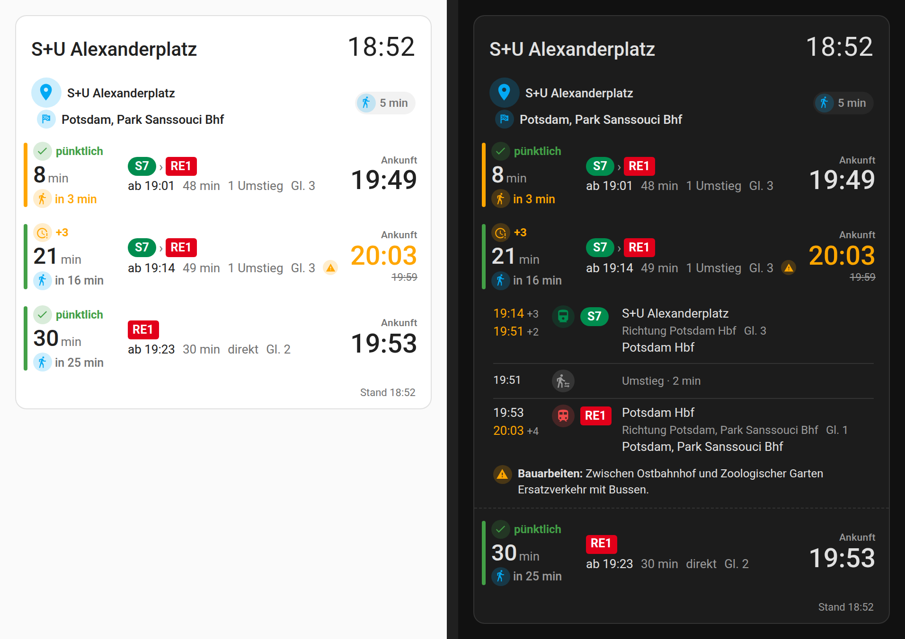
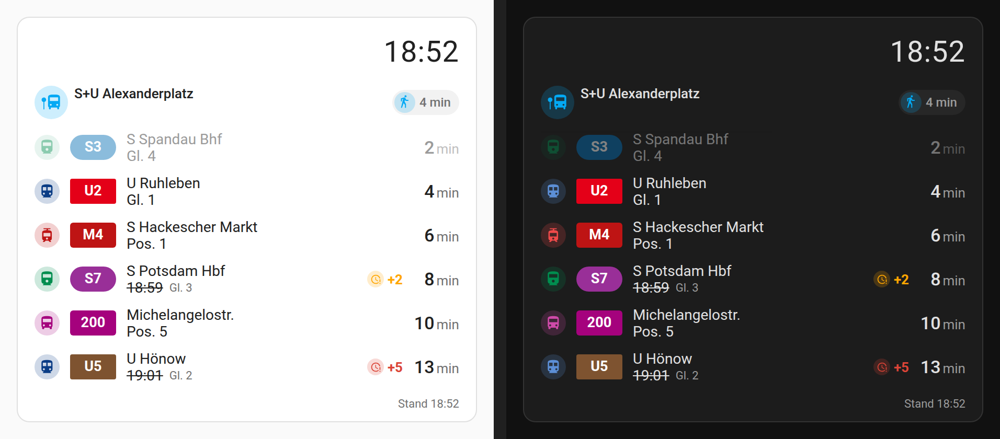
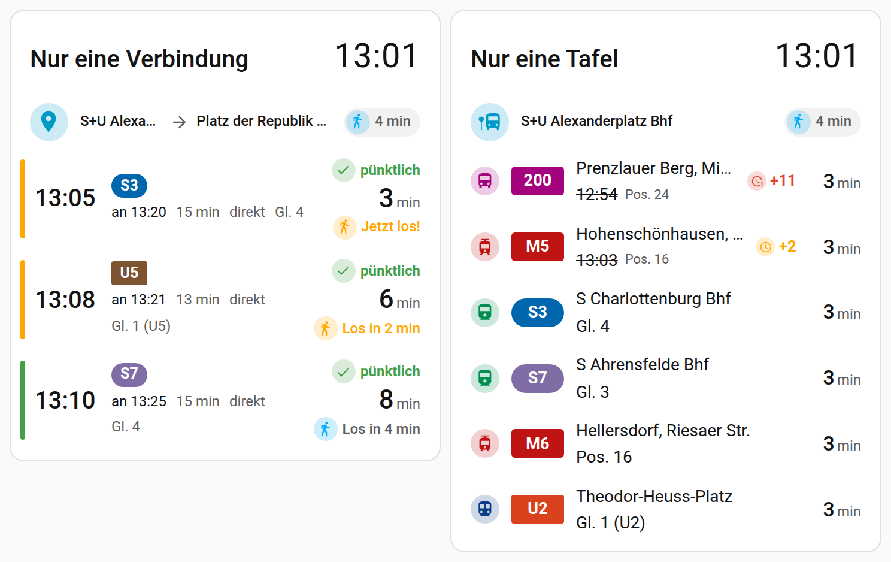
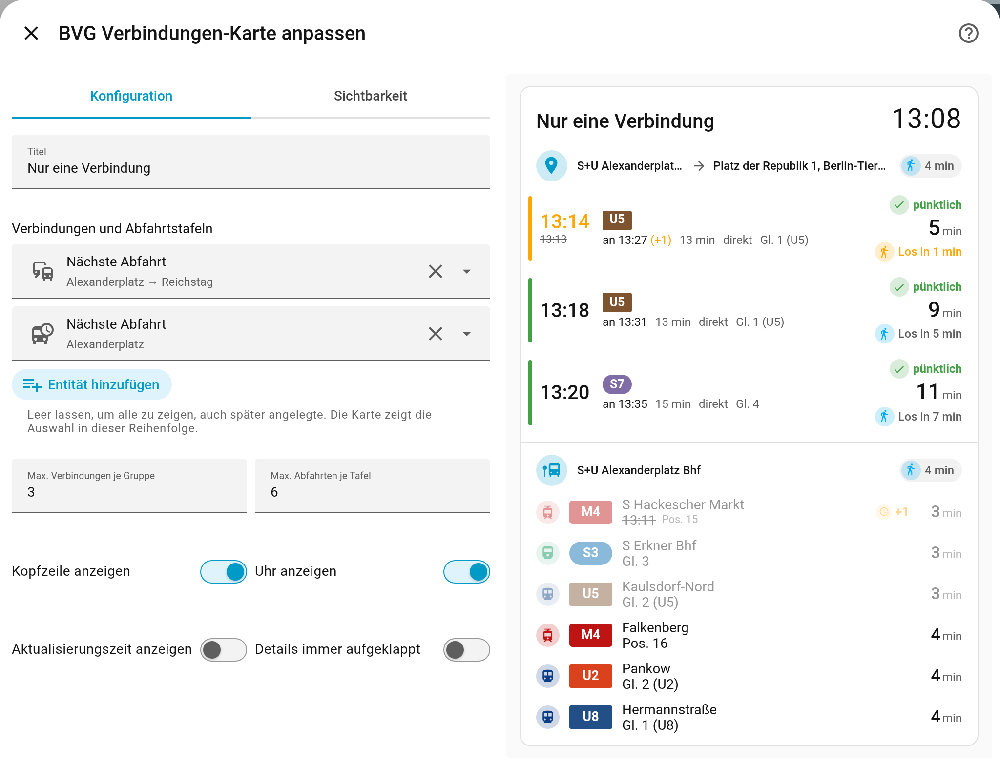

<p align="center">
  
</p>

# BVG Verbindungen für Home Assistant

[](https://github.com/MaxDeavy/ha-bvg-connections/actions/workflows/validate.yml)
[](https://github.com/MaxDeavy/ha-bvg-connections/actions/workflows/ci.yml)
[](https://github.com/hacs/default)
[](https://www.home-assistant.io/integrations/marketplace/)

Verbindungen mit Umstiegen und Abfahrtstafeln für den Berliner ÖPNV (BVG, S-Bahn, Regionalverkehr) – als Home-Assistant-Integration mit eigener Lovelace-Karte.

*English version below.*

> [!TIP]
> **Wo lege ich Verbindungen an?** Nicht über „Integration hinzufügen“, sondern auf der Seite der Integration: *Einstellungen → Geräte & Dienste → BVG Verbindungen* → oben die Knöpfe **„Verbindung hinzufügen“** bzw. **„Abfahrtstafel hinzufügen“**. Details in [Schritt 3](#3-verbindungen-und-abfahrtstafeln-anlegen).

<p align="center">
  
</p>
<p align="center">
  
</p>

## Funktionen

- **Verbindungen von A nach B** mit allen Umstiegen. Start und Ziel können Haltestellen, Adressen oder Orte sein.
- **Abfahrtstafeln** für beliebige Haltestellen, optional gefiltert nach Verkehrsmittel, Linie und Richtung.
- **Fußweg zur Haltestelle** pro Verbindung bzw. Tafel: Die Integration blendet Fahrten aus, die du nicht mehr erreichst, und die Karte zeigt „Los in X min“ bzw. „Jetzt los!“.
- **Echtzeit:** Verspätungen, Ausfälle, gefährdete Anschlüsse, Gleiswechsel, Auslastung und Störungsmeldungen.
- **Lovelace-Karte** im nativen Home-Assistant-Look (helles und dunkles Theme): Linien-Badges in BVG-Farben, Symbole in farbigen Kreisen wie bei den HA-Kachelkarten (nach Verkehrsmittel und Status eingefärbt), Umstiegsketten, Countdown, Dringlichkeitsbalken, aufklappbare Fahrtdetails, Uhr und grafischer Editor.
- **Eigenes Symbol und Logo:** Nach der Installation zeigt Home Assistant sie unter Geräte & Dienste und im Marketplace aus dem Ordner `brand/` (kein Brands-Repository nötig).
- **Alles über die Oberfläche:** Verbindungen und Tafeln sind Unterelemente (Config Subentries) der Integration und lassen sich jederzeit hinzufügen, bearbeiten oder löschen.
- **Schonend zur API:** Request-Budget mit Token-Bucket (Standard 40/min, die öffentliche API erlaubt 100/min), Backoff bei Fehlern, die letzten Daten bleiben bei Ausfällen sichtbar, Reparaturhinweis bei längerem Ausfall.

Datenquelle ist [`v6.bvg.transport.rest`](https://v6.bvg.transport.rest) (Community-Dienst ohne SLA, keine Anmeldung nötig). Eine selbst gehostete [`bvg-rest`](https://github.com/derhuerst/bvg-rest)-Instanz funktioniert ebenfalls.

## Installation und Einrichtung

Voraussetzung: Home Assistant **2026.10** oder neuer. Ab **2026.11** installierst du über den eingebauten **Marketplace** (*Einstellungen → Marketplace*). Auf **2026.10** kannst du noch den separaten HACS nutzen (siehe Hinweis unten).

### 1. Integration installieren

**Home Assistant 2026.11 oder neuer (empfohlen):**

1. *Einstellungen → Marketplace* öffnen (beim ersten Mal den Hinweis bestätigen).
2. Nach **BVG Verbindungen** suchen → Repository öffnen → **Installieren**.
3. Home Assistant **neu starten**, falls Home Assistant danach fragt (*Einstellungen → System → Reparaturen* bzw. *Neu starten*).

**Home Assistant 2026.10:** HACS öffnen → nach **BVG Verbindungen** suchen → **Herunterladen** → Home Assistant **neu starten**. Ab 2026.11 ersetzt der Marketplace die eigenständige HACS-Integration; bestehende Downloads bleiben erhalten.

Custom Repository / „Add from link“, Zip-Kopie ohne Marketplace/HACS oder lokale Entwickler-Installation: [Manuelle Installation / Custom Repository](docs/MANUAL_INSTALL.md).

### 2. Integration hinzufügen

1. *Einstellungen → Geräte & Dienste → **Integration hinzufügen*** → nach **BVG Verbindungen** suchen.
2. API-URL und Request-Budget bestätigen. Die Standardwerte passen.

Damit ist nur die Integration selbst angelegt; Verbindungen gibt es noch keine. (Öffnet der Marketplace die Einrichtung direkt nach der Installation, kannst du Schritt 2 überspringen.)

### 3. Verbindungen und Abfahrtstafeln anlegen

1. *Einstellungen → Geräte & Dienste* → auf **BVG Verbindungen** klicken (nicht erneut „Integration hinzufügen“).
2. Oben auf der Integrationsseite stehen die Knöpfe **„Verbindung hinzufügen“** und **„Abfahrtstafel hinzufügen“** (nicht „Dienst hinzufügen“, das legt eine zweite Integration an):

   
3. **Verbindung hinzufügen:** Start und Ziel eingeben (Haltestelle, Adresse oder Ort), passenden Treffer auswählen. Im letzten Schritt Name, **Gehzeit zur Haltestelle** (vorbelegt mit 5 min), Anzahl der Verbindungen, Verkehrsmittel, ausgeschlossene Linien, maximale Umstiege und Mindest-Umstiegszeit festlegen. Bleibt der Start leer, werden Haltestellen in der Nähe deines Zuhauses angeboten.
4. **Abfahrtstafel hinzufügen:** Haltestelle suchen, dann Gehzeit, Zeitfenster, Anzahl, Verkehrsmittel, Linien und Richtung festlegen.
5. Für jede Verbindung und Tafel entsteht ein eigenes Gerät mit Sensoren (siehe [Entitäten](#entitäten)).

**Gehzeit:** die Minuten von deiner Tür bis zur Haltestelle, pro Verbindung bzw. Tafel einzeln. Fahrten, die du zu Fuß nicht mehr erreichst, blendet die Integration aus, und die Karte zeigt „Los in X min“ bzw. „Jetzt los!“.

**Später ändern:** In der Liste auf der Integrationsseite beim Eintrag auf das **Stift-Symbol** („Neu konfigurieren“) klicken. Löschen geht über das Drei-Punkte-Menü des Eintrags. Aktualisierungsintervalle (Standard je 30 s) und Request-Budget stehen in den **Optionen** der Integration (Zahnrad).

### 4. Karte zum Dashboard hinzufügen

1. Dashboard öffnen → Stift oben rechts (**Bearbeiten**) → **Karte hinzufügen**.
2. Nach **BVG Verbindungen** suchen und auswählen. Ohne Auswahl zeigt die Karte alle Verbindungen und Abfahrtstafeln.
3. Optional: Unter **Verbindungen und Abfahrtstafeln** nur einzelne auswählen, zum Beispiel eine Karte nur für eine Verbindung und eine zweite nur für eine Abfahrtstafel. Die Karte zeigt die Auswahl in der gewählten Reihenfolge, der **Titel** gilt pro Karte.
4. Speichern.

Die Karte wird von der Integration mitgeliefert und automatisch geladen. Eine Lovelace-Ressource musst du normalerweise **nicht** anlegen. Alle Optionen gibt es auch als YAML (siehe [Karte](#karte)).

### Fehlerbehebung

- **„BVG Verbindungen“ fehlt in der Kartenauswahl oder die Karte zeigt „Konfigurationsfehler“ / „Custom element doesn't exist“:**
  1. Browser hart neu laden (Strg+Umschalt+R bzw. Cmd+Umschalt+R). In der Companion-App den Frontend-Cache zurücksetzen (*Einstellungen → Companion-App → Fehlerbehebung* bzw. *Debugging*).
  2. Prüfen, ob Home Assistant nach der Installation neu gestartet wurde.
  3. Falls die Karte weiterhin fehlt, die Ressource von Hand eintragen: *Einstellungen → Dashboards → Drei-Punkte-Menü → Ressourcen → Ressource hinzufügen*, URL `/bvg_connections/bvg-connections-card.js`, Typ **JavaScript-Modul**. Der Menüpunkt *Ressourcen* erscheint nur, wenn im Benutzerprofil der *Erweiterte Modus* aktiv ist. Doppelt geladen schadet die Karte nicht.
- **Integration erscheint nicht in der Suche:** Nach der Installation neu gestartet? Bei manueller Installation den Ordnerpfad prüfen – siehe [Manuelle Installation](docs/MANUAL_INSTALL.md).
- **Seltsames Verhalten nach einem Update oder nach Tests mit anderen Versionen:**
  1. Alte oder andere BVG-/VBB-Integrationen und alte Einträge dieser Integration unter *Geräte & Dienste* entfernen.
  2. Übrig gebliebene Ordner unter `custom_components/` löschen (z. B. alte Kopien unter anderem Namen). Dabei den ganzen Ordner löschen, auch den Unterordner `__pycache__`, den manche Dateibrowser ausblenden.
  3. Neu installieren, neu starten, Browser hart neu laden.
- **„Keine Verbindungen“ oder veraltete Daten:** `v6.bvg.transport.rest` ist ein Community-Dienst ohne SLA. Bei Ausfällen zeigt die Karte die letzten Daten mit dem Hinweis „Daten veraltet“, nach längerer Störung erscheint ein Reparaturhinweis.

## Entitäten

Pro Verbindung (ein Gerät):

| Entität | Inhalt |
|---|---|
| `sensor.<name>_nachste_abfahrt` | Zeitpunkt der nächsten erreichbaren Abfahrt. Attribut `journeys` enthält alle Verbindungen inkl. Teilstrecken (für die Karte). |
| `sensor.<name>_losgehen_um` | Wann du losgehen musst (Abfahrt minus Fußweg). |
| `sensor.<name>_fahrtdauer` | Fahrtdauer in Minuten. |
| `sensor.<name>_umstiege` | Anzahl Umstiege. |
| `sensor.<name>_verspatung` | Abfahrtsverspätung in Minuten (leer ohne Echtzeitdaten). |
| `binary_sensor.<name>_storung` | An bei Ausfall, gefährdetem Anschluss oder Störungsmeldung der nächsten Verbindung. |

Pro Abfahrtstafel: `sensor.<name>_nachste_abfahrt` (Attribut `departures`) und `binary_sensor.<name>_storung`.

Die großen Listen-Attribute werden nicht in der Recorder-Datenbank gespeichert. Die Minuten bis zur Abfahrt rechnet die Karte selbst aus, dafür sind keine zusätzlichen Abfragen nötig.

## Karte

```yaml
type: custom:bvg-connections-card
title: Unterwegs             # optional, pro Karte
entries:                     # optional; weglassen oder leer = alle Verbindungen und Tafeln
  - sensor.alexanderplatz_reichstag_nachste_abfahrt
  - entity: sensor.zoo_hauptbahnhof_nachste_abfahrt
    name: Über Zoo           # optional eigener Gruppenname
  - sensor.alexanderplatz_nachste_abfahrt   # Tafeln und Verbindungen beliebig gemischt
max_journeys: 3              # je Verbindung, Standard 3
max_departures: 6            # je Tafel, Standard 6
show_header: true
show_clock: true
show_footer: true            # „Stand 10:05“
expand: false                # Fahrtdetails immer aufgeklappt
```

In `entries` gehören die Sensoren „Nächste Abfahrt“ deiner Verbindungen und Tafeln. Die Karte zeigt sie in der angegebenen Reihenfolge. Ohne `entries` zeigt sie alle, erst die Verbindungen, dann die Tafeln, und nimmt neu angelegte automatisch auf. So kannst du eine Karte mit allem und zusätzlich Karten für einzelne Wege oder Haltestellen anlegen. Karten aus Version 0.1 mit `connections:` und `departures:` funktionieren weiter; der Editor stellt sie beim nächsten Speichern auf `entries` um.

<p align="center">
  
  
</p>

Ein Tipp auf eine Verbindung klappt die Details auf (Teilstrecken, Fußwege, Richtung, Gleis, Auslastung, Hinweise). Der farbige Balken links zeigt, wie dringend du los musst: grün = entspannt, orange = bald/jetzt, rot = nicht mehr zu schaffen oder Ausfall.

---

## English

Journeys with transfers and departure boards for Berlin public transport (BVG, S-Bahn, regional trains), as a Home Assistant integration with a bundled Lovelace card.

**Features:** journeys from stop/address/place to stop/address/place with all transfers; departure boards with product, line and direction filters; per-entry walking time that hides connections you can no longer catch and drives “leave in X min” hints; realtime delays, cancellations, at-risk connections, platform changes, occupancy and disruption notices; a native-looking card (light and dark theme) with BVG-coloured line badges, tile-style symbols (MDI icons in tinted circles, coloured by product and status), transfer chains, countdowns, urgency bars, expandable trip details and a visual editor; its own icon and logo from the integration's `brand/` folder (shown in Devices & services and in the Marketplace after install; no Brands repository needed); everything configured in the UI via config subentries; a request budget (default 40/min, the public API allows 100/min), backoff, stale-data display and a repair issue on longer outages.

> [!TIP]
> **Where do I add connections?** Not via “Add integration”, but on the integration's own page: *Settings → Devices & services → BVG Verbindungen* → the **“Verbindung hinzufügen”** (add connection) and **“Abfahrtstafel hinzufügen”** (add departure board) buttons at the top.

**Setup, step by step** (requires Home Assistant 2026.10 or newer; on **2026.11+** use the built-in **Marketplace**):

1. **Install (HA 2026.11+):** *Settings → Marketplace* → search **BVG Verbindungen** → **Install** → restart Home Assistant if prompted. **On HA 2026.10:** HACS → search **BVG Verbindungen** → **Download** → restart. From 2026.11 the Marketplace replaces the standalone HACS integration; existing downloads keep working. Custom repository / “Add from link”, zip copy, or local developer install: [Manual install / Custom repository](docs/MANUAL_INSTALL.md).
2. **Add the integration:** *Settings → Devices & services → **Add integration** → BVG Verbindungen*. The defaults are fine. This creates the integration only, no connections yet. (Skip this step if the Marketplace already opened the setup dialog.)
3. **Add connections and boards:** open *Settings → Devices & services → **BVG Verbindungen*** and use the **“Verbindung hinzufügen”** / **“Abfahrtstafel hinzufügen”** buttons at the top (not “Dienst hinzufügen” / “Add service”, which creates a second integration entry). Search origin and destination (stop, address or place), pick the match, then set name, **walking time to the stop** (prefilled with 5 min), number of results, products, excluded lines, max. transfers and min. transfer time. Change an entry later with its **pencil icon** (“Reconfigure”). Polling intervals (default 30 s each) and the request budget are in the integration **options** (gear icon).
4. **Add the card:** dashboard → **Edit** → **Add card** → search **BVG Verbindungen**. Without a selection the card shows all connections and departure boards; pick individual ones under **“Verbindungen und Abfahrtstafeln”** for a card per route or stop (shown in the order you pick them, with a title per card). The integration serves and loads the card itself, so no Lovelace resource is needed.

**Troubleshooting:**

- *Card missing from the picker, or “Configuration error” / “Custom element doesn't exist”:* hard-reload the browser (Ctrl+Shift+R; Companion app: reset the frontend cache) and make sure you restarted after installing. If it is still missing, add the resource manually: *Settings → Dashboards → three-dot menu → Resources → Add resource*, URL `/bvg_connections/bvg-connections-card.js`, type **JavaScript module** (the *Resources* entry needs *Advanced mode* in your user profile).
- *Integration not found:* restarted after installing? For a manual install, check the folder path — see [Manual install](docs/MANUAL_INSTALL.md).
- *Odd behaviour after updates or tests with other versions:* remove old or other BVG/VBB integrations and old entries of this one, delete leftover folders under `custom_components/` completely (including the `__pycache__` subfolder that some file browsers hide), reinstall, restart and hard-reload.

**Card:** see the YAML example above; all options are also available in the visual editor. `entries` lists the “next departure” sensors of connections and boards in display order; leave it out to show all of them, including ones added later. Cards from 0.1 with `connections:` / `departures:` keep working and are switched to `entries` when saved in the editor.

## Changelog

Siehe / see [CHANGELOG.md](CHANGELOG.md). Mitwirken / contributing: [CONTRIBUTING.md](CONTRIBUTING.md).

## Lizenz / License

MIT, siehe [LICENSE](LICENSE). Fahrplandaten: VBB/BVG via HAFAS und transport.rest.
